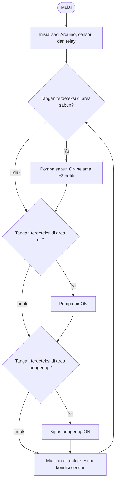
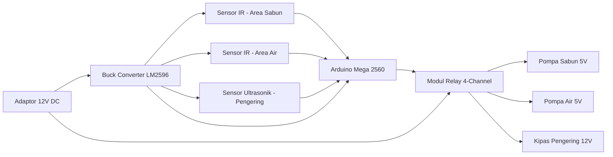

# Automatic Hand Wash & Hand Dryer System

Sistem cuci tangan dan pengering tangan otomatis berbasis mikrokontroler
Arduino Mega 2560. Proyek ini mengintegrasikan pendeteksian tangan,
pemberian sabun, pengaliran air, dan pengeringan tangan dalam satu
prototipe **touchless** untuk mendukung higienitas serta efisiensi
penggunaan air dan energi.

> **Project type:** Embedded Systems / Internet of Things (IoT-ready)\
> **Status:** Prototype implemented and functionally tested\
> **Main controller:** Arduino Mega 2560\
> **Programming language:** Arduino C/C++\
> **Development environment:** Arduino IDE

## Daftar Isi

-   [Tentang Proyek](#tentang-proyek)
-   [Latar Belakang](#latar-belakang)
-   [Fitur Utama](#fitur-utama)
-   [Cara Kerja Sistem](#cara-kerja-sistem)
-   [Arsitektur Sistem](#arsitektur-sistem)
-   [Komponen dan Teknologi](#komponen-dan-teknologi)
-   [Perangkat Lunak](#perangkat-lunak)
-   [Struktur Repository](#struktur-repository)
-   [Pengujian dan Hasil](#pengujian-dan-hasil)
-   [Instalasi dan Menjalankan
    Program](#instalasi-dan-menjalankan-program)
-   [Dokumentasi](#dokumentasi)
-   [Keterbatasan dan Pengembangan
    Berikutnya](#keterbatasan-dan-pengembangan-berikutnya)
-   [Kontributor](#kontributor)
-   [Lisensi dan Hak Cipta](#lisensi-dan-hak-cipta)

## Tentang Proyek

**Automatic Hand Wash & Hand Dryer System** adalah prototipe perangkat
otomatis yang dirancang untuk mengurangi kebutuhan menyentuh keran
maupun tombol pengering. Sensor mendeteksi keberadaan tangan pada area
sabun, area pencucian, dan area pengeringan. Arduino Mega 2560 memproses
masukan sensor, kemudian mengendalikan pompa dan kipas melalui modul
relay 4-channel.

Sistem menggabungkan dua bagian utama:

1.  **Hardware:** sensor, mikrokontroler, modul relay, pompa, kipas,
    rangkaian catu daya, dan PCB.
2.  **Software:** program Arduino C/C++ untuk inisialisasi perangkat,
    pembacaan sensor, pemrosesan logika, serta pengendalian aktuator.

Proyek ini dikembangkan sebagai prototipe untuk menerapkan konsep
embedded system dan otomatisasi tanpa sentuhan.

## Latar Belakang

Fasilitas cuci tangan konvensional masih mengharuskan pengguna menyentuh
keran atau tombol pengering. Permukaan yang digunakan bersama dapat
menjadi titik perpindahan kontaminasi. Sistem otomatis tanpa sentuhan
menawarkan alternatif dengan mengaktifkan perangkat berdasarkan deteksi
tangan.

Tujuan pengembangan proyek ini adalah:

-   Mengembangkan sistem cuci tangan dan pengering tangan otomatis
    berbasis sensor.
-   Mengintegrasikan proses pemberian sabun, pencucian, dan pengeringan
    dalam satu sistem.
-   Mengaktifkan aktuator hanya ketika diperlukan untuk mendukung
    efisiensi air dan energi.
-   Menerapkan kemampuan perancangan rangkaian, pemrograman
    mikrokontroler, integrasi, dan pengujian prototipe.

## Fitur Utama

  -----------------------------------------------------------------------
  Fitur                               Deskripsi
  ----------------------------------- -----------------------------------
  Deteksi tangan tanpa sentuhan       Sensor mendeteksi tangan pada area
                                      penggunaan tanpa tombol manual.

  Dispenser sabun otomatis            Pompa sabun aktif selama sekitar 3
                                      detik ketika tangan terdeteksi di
                                      area sabun.

  Aliran air otomatis                 Pompa air aktif selama tangan
                                      terdeteksi pada area pencucian.

  Pengering tangan otomatis           Kipas aktif ketika sensor
                                      mendeteksi tangan pada area
                                      pengering dan berhenti ketika
                                      tangan menjauh.

  Kendali terpusat                    Arduino Mega 2560 memproses masukan
                                      sensor dan mengendalikan aktuator.

  Kendali melalui relay               Modul relay menjadi saklar untuk
                                      mengendalikan beban pompa dan
                                      kipas.
  -----------------------------------------------------------------------

## Cara Kerja Sistem

Sistem menjalankan proses berikut secara berulang:

1.  **Inisialisasi:** Arduino mengatur pin sensor dan relay. Aktuator
    diatur ke kondisi awal tidak aktif.
2.  **Pemberian sabun:** ketika sensor IR pada area sabun mendeteksi
    tangan, pompa sabun aktif selama kurang lebih 3.000 ms, kemudian
    mati otomatis.
3.  **Pencucian tangan:** ketika sensor IR pada area air mendeteksi
    tangan, pompa air menyala. Pompa berhenti ketika tangan tidak lagi
    terdeteksi.
4.  **Pengeringan tangan:** sensor ultrasonik mengukur jarak tangan.
    Ketika jarak berada di bawah nilai ambang (*threshold*) yang
    ditentukan, kipas pengering menyala. Kipas mati ketika tangan
    menjauh.
5.  **Kembali ke kondisi siaga:** setelah tidak ada tangan yang
    terdeteksi, sistem kembali membaca sensor dan siap digunakan
    kembali.

### Diagram Alur Sederhana



*Diagram di atas merupakan ringkasan alur penggunaan. Detail pembacaan
sensor dan kontrol aktuator mengikuti implementasi program pada
repository.*

## Arsitektur Sistem



Arduino bertindak sebagai pusat kendali. Sensor menjadi masukan,
sedangkan pompa dan kipas merupakan keluaran yang dikendalikan melalui
relay. Catu daya utama berasal dari adaptor 12V DC dan buck converter
LM2596 digunakan untuk menyediakan tegangan 5V bagi bagian yang
membutuhkannya.

## Komponen dan Teknologi

  -----------------------------------------------------------------------
  Komponen                Jumlah / spesifikasi    Fungsi
                          dalam rancangan         
  ----------------------- ----------------------- -----------------------
  Arduino Mega 2560       1 unit                  Mikrokontroler utama
                                                  untuk membaca sensor
                                                  dan mengendalikan
                                                  aktuator.

  Sensor IR Obstacle      2 unit                  Mendeteksi tangan pada
                                                  area sabun dan area
                                                  air.

  Sensor ultrasonik       1 unit                  Mengukur jarak tangan
                                                  pada area pengering.

  Pompa DC 5V             2 unit                  Memompa sabun dan air.

  Kipas DC 12V            Sistem pengering        Menghasilkan aliran
                                                  udara untuk
                                                  mengeringkan tangan.

  Modul relay 4-channel   1 unit                  Mengendalikan aktuator
  5V                                              berdasarkan perintah
                                                  Arduino.

  Buck converter LM2596   1 unit                  Menurunkan tegangan 12V
                                                  menjadi 5V.

  Adaptor 12V DC 2A       1 unit                  Sumber daya utama
                                                  sistem.

  DC barrel jack          1 unit                  Konektor masukan daya
                                                  adaptor.

  PCB prototipe dan kabel \-                      Media perakitan dan
  silikon                                         penghubung rangkaian.
  -----------------------------------------------------------------------

**Catatan konfigurasi:** laporan menjelaskan dua pompa 5V untuk sabun
dan air. Bagian implementasi juga menjelaskan dua kipas 12V yang
dikendalikan melalui relay 3 dan 4 secara paralel. Jumlah/konfigurasi
kipas sebaiknya disesuaikan dengan perangkat fisik yang benar-benar
digunakan pada versi akhir prototipe.

### Pembagian Kendali

  -----------------------------------------------------------------------
  Masukan                 Area                    Keluaran
  ----------------------- ----------------------- -----------------------
  Sensor IR 1             Sabun                   Pompa sabun melalui
                                                  relay 1

  Sensor IR 2             Air                     Pompa air melalui relay
                                                  2

  Sensor ultrasonik       Pengering               Kipas pengering melalui
                                                  relay 3 dan 4
                                                  sebagaimana dijelaskan
                                                  pada implementasi
  -----------------------------------------------------------------------

## Perangkat Lunak

-   **Bahasa pemrograman:** Arduino C/C++.
-   **IDE:** Arduino IDE.
-   **Platform mikrokontroler:** Arduino Mega 2560.
-   **Pendekatan program:** modular, terdiri dari inisialisasi,
    pembacaan sensor, logika utama, dan kendali aktuator.

Fungsi yang dijelaskan dalam rancangan program meliputi:

  -----------------------------------------------------------------------
  Fungsi / bagian                     Tanggung jawab
  ----------------------------------- -----------------------------------
  `setup()`                           Menginisialisasi sensor, relay, dan
                                      kondisi awal output.

  `loop()`                            Menjalankan pembacaan sensor dan
                                      logika utama secara berulang.

  Pembacaan IR                        Membaca status sensor pada area
                                      sabun dan air.

  Pengukuran ultrasonik               Mengukur jarak tangan pada area
                                      pengering.

  Kontrol pompa sabun                 Mengaktifkan pompa sabun selama
                                      durasi yang ditentukan.

  Kontrol pompa air                   Mengaktifkan pompa selama tangan
                                      terdeteksi.

  Kontrol kipas                       Mengaktifkan kipas berdasarkan
                                      hasil deteksi sensor ultrasonik.
  -----------------------------------------------------------------------

## Struktur Repository

``` text
hand-wash-automatic-system/
├── Code_Sistan_Final_Kel10/
│   └── Code_Sistan_Final_Kel10.ino
├── PPT-KELOMPOK 10.pptx
├── .gitignore
└── README.md
```

Nama dan susunan file dapat berbeda jika ada pembaruan pada repository.
Dokumen laporan lengkap tidak disertakan dalam struktur ini.

## Pengujian dan Hasil

Pengujian dilakukan dengan metode *functional testing*. Setiap sensor
dan aktuator diuji terlebih dahulu, kemudian sistem diuji secara
terintegrasi.

### Hasil Pengujian Sensor

  -----------------------------------------------------------------------
  Sensor / area           Kondisi uji             Respons yang dicatat
  ----------------------- ----------------------- -----------------------
  IR -- sabun             Tangan terdeteksi pada  Pompa sabun ON
                          jarak 3 cm              

  IR -- sabun             Tangan tidak terdeteksi Pompa sabun OFF
                          pada jarak lebih dari   
                          10 cm                   

  IR -- air               Tangan terdeteksi pada  Pompa air ON
                          jarak 4 cm              

  IR -- air               Tangan tidak terdeteksi Pompa air OFF
                          pada jarak lebih dari   
                          10 cm                   

  Ultrasonik -- pengering Tangan terdeteksi pada  Kipas ON
                          jarak 6 cm              

  Ultrasonik -- pengering Tangan tidak terdeteksi Kipas OFF
                          pada jarak lebih dari   
                          15 cm                   
  -----------------------------------------------------------------------

### Hasil Pengujian Aktuator

-   Pompa sabun menyala sekitar 3 detik ketika sensor area sabun aktif.
-   Pompa sabun mati ketika tidak ada pemicu atau setelah durasi
    selesai.
-   Pompa air menyala ketika tangan terdeteksi dan mati ketika tangan
    tidak terdeteksi.
-   Kipas pengering menyala ketika tangan terdeteksi di area pengering
    dan mati ketika tangan menjauh.

### Pengujian Sistem Terintegrasi

Skenario pengujian meliputi penggunaan normal dari area sabun ke area
air lalu area pengering, penggunaan yang melewati salah satu tahapan,
deteksi tangan berulang, serta penggunaan berulang. Laporan menyatakan
sistem merespons sesuai alur yang dirancang dan dapat menjalankan fungsi
otomatisnya.

### Kendala dan Penanganan

  -----------------------------------------------------------------------
  Kendala                             Penanganan yang dilakukan
  ----------------------------------- -----------------------------------
  Pembacaan sensor tidak stabil       Menyesuaikan posisi/jarak sensor
                                      dan nilai threshold.

  Relay tidak aktif                   Memeriksa koneksi dan melakukan
                                      penyolderan ulang jika diperlukan.

  Pompa terlambat menyala             Mengoptimalkan program dan waktu
                                      jeda.

  Pembacaan ultrasonik kurang akurat  Menyesuaikan posisi sensor.

  Sistem restart                      Memeriksa kestabilan buck converter
                                      dan koneksi ground bersama.
  -----------------------------------------------------------------------

## Instalasi dan Menjalankan Program

1.  Pasang **Arduino IDE** pada komputer.
2.  Buka file `Code_Sistan_Final_Kel10.ino` dari folder
    `Code_Sistan_Final_Kel10`.
3.  Hubungkan Arduino Mega 2560 ke komputer menggunakan kabel USB yang
    sesuai.
4.  Pada Arduino IDE, pilih board **Arduino Mega or Mega 2560**.
5.  Pilih port COM yang sesuai dengan perangkat Arduino.
6.  Periksa kembali konfigurasi pin pada kode agar sesuai dengan wiring
    prototipe.
7.  Klik **Verify** untuk memeriksa kompilasi program.
8.  Jika tidak ada kesalahan kompilasi, klik **Upload** untuk mengunggah
    program ke Arduino.
9.  Uji sensor dan aktuator secara bertahap sebelum menjalankan sistem
    secara keseluruhan.

> **Penting:** pastikan tegangan, polaritas, arus adaptor, koneksi
> relay, dan wiring aktuator sesuai spesifikasi komponen. Jangan
> menghubungkan pompa atau kipas langsung ke pin I/O Arduino. Lakukan
> pengujian rangkaian dengan pengawasan yang memadai dan matikan catu
> daya sebelum mengubah wiring.

## Dokumentasi

Repository ini memuat kode program dan materi presentasi proyek.
Dokumentasi visual tambahan yang dapat ditambahkan:

-   Foto prototipe secara keseluruhan.
-   Foto perakitan komponen pada PCB.
-   Foto wiring sisi bawah PCB.
-   Diagram blok dan skema rangkaian.
-   Dokumentasi pengujian sensor dan aktuator.

Letakkan gambar yang memang boleh dipublikasikan di folder
`docs/images/`, lalu tampilkan menggunakan tautan relatif, misalnya:

``` markdown

```

## Keterbatasan dan Pengembangan Berikutnya

Berdasarkan evaluasi pada laporan, beberapa pengembangan yang dapat
dilakukan adalah:

1.  **Meningkatkan performa pengering:** mempertimbangkan blower yang
    sesuai agar proses pengeringan lebih cepat. Penambahan elemen
    pemanas memerlukan perancangan keselamatan dan proteksi yang
    memadai.
2.  **Menyempurnakan casing:** membuat casing ergonomis dan tahan
    cipratan air untuk melindungi PCB, relay, dan komponen elektronik.
3.  **Meningkatkan presisi pompa sabun:** mempertimbangkan pompa
    peristaltik agar dosis sabun lebih terukur dan risiko penyumbatan
    berkurang.
4.  **Menambahkan indikator status:** menggunakan LED atau LCD untuk
    menampilkan status sistem dan informasi persediaan air/sabun.

## Kontributor

Proyek ini dikerjakan oleh:

-   **Bona Maruli Panjaitan** --- 43324035
-   **Joice Simaremare** --- 43324037
-   **Sri Indah Permata Silalahi** --- 43324053

## Lisensi dan Hak Cipta

Kode program dan dokumentasi proyek pada repository ini dibagikan untuk
tujuan pembelajaran dan portofolio. Hak atas setiap materi pihak ketiga
tetap mengikuti ketentuan pemiliknya.

**Catatan mengenai laporan:** file laporan yang diberikan mencantumkan
pemberitahuan hak cipta penerbit PT. Ganesha Kreasi Semesta dan larangan
memperbanyak atau memindahkan isi tanpa izin tertulis. Oleh karena itu,
README ini menyajikan ringkasan teknis proyek dengan kata-kata sendiri
dan tidak menyertakan salinan laporan lengkap. Jangan mengunggah PDF
laporan tersebut ke repository publik tanpa izin tertulis dari penerbit.

------------------------------------------------------------------------

*README ini disusun berdasarkan isi laporan proyek "Perancangan Sistem
Hand Wash dan Pengering Tangan Otomatis Berbasis Mikrokontroler".*
